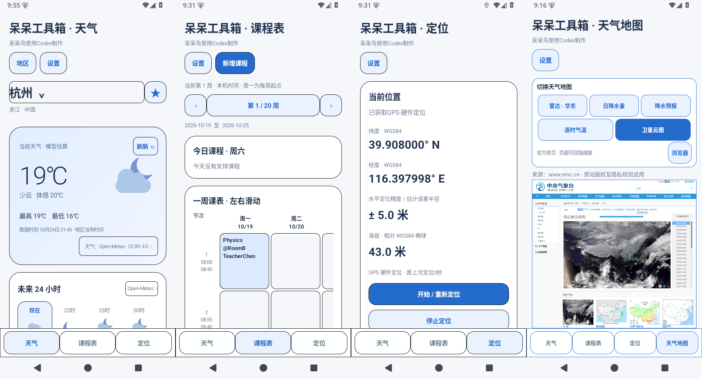
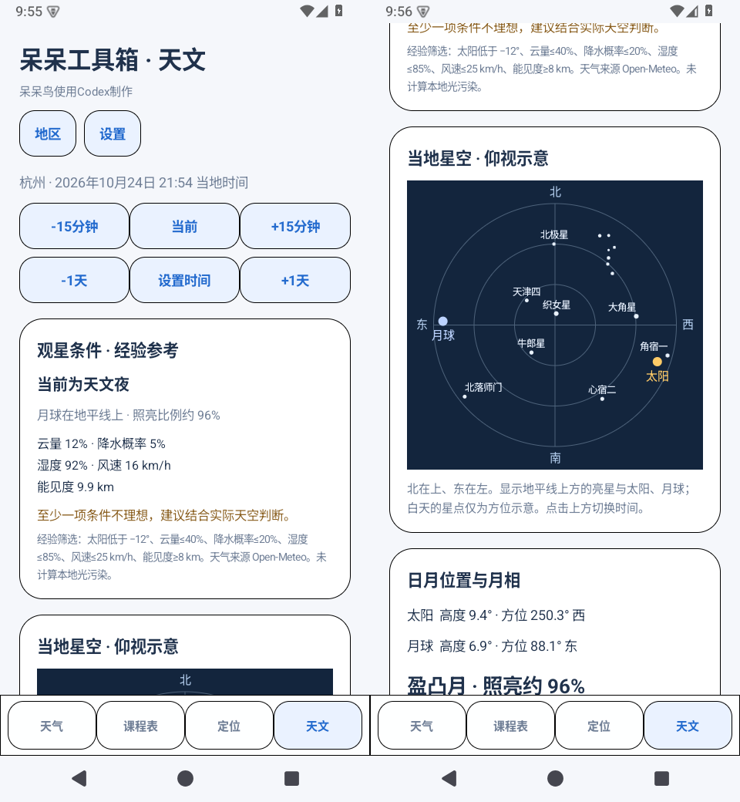

# 呆呆工具箱

呆呆鸟使用 Codex 制作的简洁 Android 工具箱，适合个人非商业使用。Android 8.0 及以上，无广告、无需账号。

- **天气**：选择地区、收藏、当前天气、未来24小时与7日预报，支持缓存与栏目排序。
- **课程表**：手动添加课程、地点、教师；自定义上课时间、学期和任意授课周。
- **定位**：GPS硬件或系统网络定位，显示经纬度、误差、结果年龄；更新间隔可选1秒至10分钟。
- **天气地图**：中央气象台日降水量、降水预报、气温、区域雷达及卫星云图的完整官方网页。
- **天文**：当地星空示意、太阳与月球位置、月相、曙暮光，可设置时间。
- **个性设置**：导入图片并拖动缩放裁剪、背景亮度、描边颜色、栏目显隐与排序。

天气地图和天文默认隐藏，可在“设置 → 底部栏目”开启。

## 下载

| 版本 | 下载与说明 |
| --- | --- |
| **1.0.2 最新版** | [APK、源码与更新记录](https://github.com/AdybirdZ/daidai-toolbox/releases/tag/v1.0.2) |
| 1.0.1 | [历史版本](https://github.com/AdybirdZ/daidai-toolbox/releases/tag/v1.0.1) |
| 1.0.0 | [历史版本](https://github.com/AdybirdZ/daidai-toolbox/releases/tag/v1.0.0) |
| 0.1.0-test | [早期简天气测试版](https://github.com/AdybirdZ/daidai-toolbox/releases/tag/v0.1.0-test) |

在对应 Release 的 Assets 中下载 `.apk` 安装。包名 `org.simpleweather.app`，各版沿用同一开发签名；更新请直接覆盖安装以保留数据，不要先卸载。不要用历史版本降级覆盖新版。

1.0.2 已包含最后的界面调整：天气来源按钮位于卡片右下角；天文第一行依次为“-15分钟、当前、+15分钟”；星图天体标签下移；天文统一使用“月球”。

[完整更新记录](CHANGELOG.md) · [验证记录](TESTING.md) · [数据授权与隐私](docs/DATA-LICENSE.md)

## 预览





## 数据、隐私与许可

天气由 [Open-Meteo](https://open-meteo.com/) 提供，地区数据来自 [GeoNames](https://www.geonames.org/)，按 CC BY 4.0 署名。客户端对描述、数值和排版作了处理。**免费托管API仅限非商业使用**；如需广告、收费或商业运营，应先另行取得服务授权。

全国天气图和卫星云图只浏览完整官方网页，保留原站版权与时间信息；本项目没有取得官方图片API或图片再分发授权。天文结果为本地近似估算，不用于测量或导航。

无统计SDK或自建服务器。课程表和背景只保存在本机；应用不上传定位坐标。网络定位依赖手机系统服务，实际回调频率、精度及其隐私规则由系统和服务商决定。天气查询需要向Open-Meteo发送所选地区坐标，官方网页遵循各自隐私规则。

新写客户端源码采用 [MIT License](LICENSE)，数据与服务条款另见 [NOTICE](NOTICE.md) 和 [授权说明](docs/DATA-LICENSE.md)。参考项目为[天气战士](https://github.com/anyin233/weather-fighter-global)和[时光课表](https://github.com/XingHeYuZhuan/shiguangschedule)，本项目独立编写原生客户端，未复制其代码或视觉资产。

## 构建

需要JDK17+、Python3、Android SDK `platforms;android-35` 与 `build-tools;35.0.0`：

```powershell
python build.py --sdk C:/Android/Sdk --out build/DaidaiToolbox-1.0.2.apk
```

脚本执行aapt2、javac、D8、zipalign和apksigner。首次构建会生成本地开发密钥。**本仓库不含已发布APK的签名私钥**，自行生成的不同密钥不能覆盖已发布APK。Android Studio可打开Gradle项目，本次验证的是Python构建路线。

核心检查使用测试专用 [JSON-java 20240303](https://repo.maven.apache.org/maven2/org/json/json/20240303/json-20240303.jar)，不包含于APK：

```powershell
python tests/run.py --json-jar C:/path/json-20240303.jar
```

120项核心检查通过，并验证Android15模拟器覆盖升级、设置、定位请求间隔及界面。真实设备、OEM网络定位与旧Android版本仍需实测。
